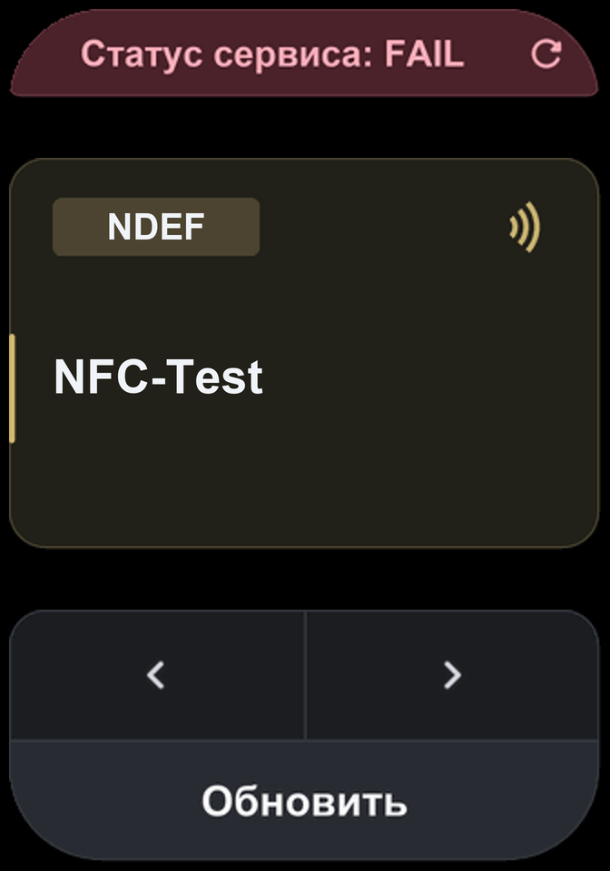
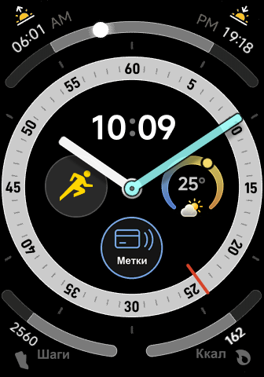

# MiBandNFC — APDU Band Bridge

**English:** A research prototype for an NFC ↔ BLE ↔ Android bridge on
**Mi Smart Band 10 Pro Ceramic Global** (`miwear.watch.p67glt`, firmware
**3.201.026**) and **Google Pixel 8a**. It relays synthetic APDUs and read-only
NDEF content. It does **not** implement Mir Pay or real payments.

**Русский:** Исследовательский прототип моста **NFC ↔ BLE ↔ Android** для
Mi Smart Band 10 Pro Ceramic Global (`miwear.watch.p67glt`, прошивка
**3.201.026**) и Pixel 8a. Он передаёт синтетические APDU и read-only NDEF.
**Mir Pay и реальные платежи здесь не реализованы.**

> [!WARNING]
> Это не платёжное приложение. В проекте нет платёжных AID, данных карт,
> доступа к защищённому элементу или Mir Pay. Синтетический тест проверяет
> только транспорт. Модуль использует адреса конкретной прошивки и должен
> применяться только на точной модели `p67glt` / **3.201.026**.

## Статус

Текущий релиз проекта **[v1.0.0](https://github.com/RarogVA/MiBandNFC/releases/tag/v1.0.0)**:
[Roundabout RU NFC 4 / UI4](releases/catalog-ui4/roundabout-ru-nfc4-p67glt.face),
[APK 0.4.1](releases/catalog-ui4/tag-bridge-0.4.1.apk),
[состав и контрольные суммы](releases/catalog-ui4/manifest.json),
[описание релиза](docs/releases/v1.0.0.md).

**UI4 «Пульт».** Новый экран содержит
крупные жирные надписи, динамический статус и карточку с равными промежутками
до верхнего и нижнего блоков. Core v1 и APK 0.4.1 сохранены без изменений.
Предыдущая страница UI3 из
[v0.4.2-alpha.1](docs/releases/v0.4.2-alpha.1.md) и её файлы сохранены.

**Pixel 0.4.1:** увеличенные карточки, меню «⋮» и чекбоксы одного размера.
Передаются только отмеченные метки; выбор сохраняется на телефоне.
[APK и проверка выборочной синхронизации](releases/tags-ui-0.4.1/README.md).

**Обновление приложения Pixel, 13.11.2026:** чёрная тема, карточки меток,
отдельные окна BLE и Debug, адаптивная иконка. APK 0.4.1 установлен; сохранённые
метки сохранены. [Сборка и проверка интерфейса](releases/tags-ui/README.md).
Проверка интерфейса не является новым аппаратным PASS NFC-каталога 0.4.

| Компонент | Проверено | Объём |
| --- | --- | --- |
| **APDU Lab** (APK 0.4 + FACE/ELF v6) | один аппаратный PASS | SELECT + свежий challenge, полный цикл NFC → BLE → Pixel → BLE → NFC, **396,5 мс** |
| **Tag Bridge** (APK 0.3 + FACE/ELF v2) | один аппаратный PASS | созданная NDEF-запись **23 байта**, **6 APDU**, независимое подтверждение BLE/ATT и очистки |
| Host-тесты | PASS | APDU Lab: **5** нативных наборов + **131** JVM-проверка; Tag Bridge: **6** наборов + **170** JVM-проверок |
| Проверка проекта | PASS | 4 релиза, **32** fingerprint прошивки, побайтовая перепаковка FACE, **160 байт** запаса ELF v6 |
| Mir Pay | **не интегрирован** | HCE-служба Mir Pay защищена `BIND_NFC_SERVICE` уровня `signature`; внешнего APDU-входа нет |

Оба аппаратных результата — **по одному прогону**. Это не серия, не проверка
сна/фона, не независимый считыватель и не платёжный терминал.

## Архитектура

```text
Pixel: NFC ReaderMode / IsoDep
          │ SELECT тестового AID, затем случайный challenge
          ▼
Браслет: NFC-контроллер → временный маршрут AID
          │ NCI DATA → нативный модуль → BLE notify
          ▼
Pixel: независимый BLE-обработчик APDU
          │ вычисление тестового ответа → BLE write с подтверждением
          ▼
Браслет: нативный модуль → штатный NFC send → ответ по RF
          │
          ▼
Pixel: IsoDep получает ответ и сверяет его с журналом BLE
```

В аппаратном тесте Pixel одновременно выполняет две роли: внешний
NFC-считыватель и удалённый обработчик APDU. PASS требует совпадения
BLE-запроса, подтверждённой ATT-записи ответа и правильного NFC-ответа.
Это проверяет транспортный цикл, но не работу с банковским терминалом.

## Что внутри

| Каталог | Назначение |
| --- | --- |
| `android/` | Android-приложение, BLE-клиент, NFC-считыватель и журнал |
| `band/` | ARM-модуль: BLE GATT, NFC-маршрутизация, очередь APDU, таймеры, очистка |
| `watchface/` | Lua-интерфейс INSTALL/STATUS и загрузка ELF |
| `tests/` | Нативные host-тесты APDU Lab |
| `tools/` | Сборка, упаковка FACE и проверка проекта |
| `diagnostics/mirpay-access/` | Отдельная диагностика доступа к HCE-службе Mir Pay |
| `tags/` | Отдельная ветка Tag Bridge: каталог меток и read-only Type 4 NDEF |
| `references/` | Шаблон FACE и точный образ прошивки для проверки привязок |
| `releases/` | Сохранённые проверенные APK, FACE, ELF и хеши |
| `docs/` | Архитектура, roadmap, ТЗ, отчёты и доказательства |

## Что проверено

- Загрузка собственного ARM-модуля через `.face` на прошивке **3.201.026**.
- Собственный BLE GATT-сервис: Pixel принимает APDU от браслета и возвращает ответ.
- Временный маршрут AID к основному процессору; исходные записи и их порядок сохраняются.
- SELECT и свежий 16-байтовый challenge проходят полный NFC/BLE-цикл.
- После теста подтверждены удаление маршрута, `STOPPED` и повторный `QUERY → STOPPED`.
- Tag Bridge: read-only Type 4 NDEF, каталог на Pixel, выбранная запись на браслете.
- Проверка проекта: 4 релиза, 32 fingerprint, повторная упаковка FACE, сохранённый challenge.

Подробности и точные байты:

- [Аппаратный отчёт APDU Lab v6](docs/evidence/pixel-gatt-v6-observation.json)
- [Журнал успешного прогона](docs/evidence/pixel-v6-pass-log.txt)
- [Аппаратный отчёт Tag Bridge](docs/evidence/tags/pixel-0.3-v2-readback.json)
- [Архитектура](docs/architecture.md)
- [Roadmap](docs/roadmap.md)

## Чего здесь нет

- **Mir Pay и реальных платежей.** Платёжные AID, карты и защищённый элемент не используются.
- **Поддержки других моделей/прошивок.** Адреса и fingerprints привязаны к `p67glt` / **3.201.026**.
- **Фоновой работы и работы после сна.** Приложение и циферблат должны быть открыты.
- **ISO-DEP WTX.** Сейчас ожидание APDU — 3 секунды, сеанс — 120 секунд.
- **Проверки реальной физической NDEF-метки.** Tag Bridge проверен на созданной записи.
- **Независимого считывателя и серии из 100 прогонов.**

## Быстрый старт

Нужны Python 3, JDK, Android SDK platform 36 / build-tools 36.0.0,
NDK **28.2.13676358** и Clang с ASAN/UBSAN. Пути задаются через
`JAVA_HOME`, `ANDROID_SDK_ROOT` / `ANDROID_HOME` и `APDU_NDK` /
`ANDROID_NDK_HOME`.

```sh
# Проверка сохранённых релизов, fingerprints и FACE
python3 tools/verify_project.py

# Нативные host-тесты + JVM APDU Lab
python3 tools/test_host.py

# Сборка APK и нативного модуля
python3 android/build.py
python3 tools/build_band.py

# Tag Bridge
python3 tags/test_host.py
python3 tags/android/build.py --test-only
python3 tags/build_band.py
```

Результаты сборки по умолчанию пишутся в `build/` и `android/build/`;
эти каталоги исключены из Git. Сохранённые релизы находятся в `releases/`.

## Ограничения

- Один успешный аппаратный прогон на ветку; повторяемость и длительная
  устойчивость не доказаны.
- ELF v6 занимает **31 112 из 31 272 байт** слота FACE: запас **160 байт**.
- Первый SELECT должен помещаться в один NCI-пакет; CAPDU ≤ 261, RAPDU ≤ 258 байт.
- Нет глобальной блокировки таблицы NFC-маршрутов штатного стека.
- Модуль остаётся в памяти до перезагрузки; `rmmod` не используется.
- При неоднозначном состоянии модуль переходит в `RECOVERY`, а не выдаёт ложный `STOPPED`.

## Mir Pay

Обычное приложение не может подключиться к HCE-службе установленного Mir Pay:
Android требует `android.permission.BIND_NFC_SERVICE` уровня `signature`.
Проверка на Pixel завершилась `SecurityException`; платёжные APDU не отправлялись.
Подробности: [отчёт](docs/evidence/mirpay/pixel-mirpay-access-report.json) и
[разбор точек входа](docs/evidence/mirpay/mirpay-entrypoint-review.json).

Это не «недоделанный BLE»: транспорт работает. Для реального платежа нужен
поддерживаемый платёжный контракт — Mir HCE SDK, токенизация, банк-партнёр и
сертификация НСПК. Проект этот барьер не обходит.

## Roundabout RU NFC 4 и экран «Пульт»

Первое нажатие нижнего круга «Метки» после перезагрузки загружает модули и
открывает каталог. UI4 использует всё поле 336×480 с отступами 5 px и учитывает
скругление краёв. Оливковая карточка отличается от тёмных кнопок; тип метки
расположен сверху слева в бейдже 114×32 px, NFC-значок — сверху справа, название — у акцентной полоски.

Название — **26 px**, тип и статус — **20 px**, «Обновить» — **23 px**;
все надписи жирные. Между статусом и карточкой и между карточкой и нижним
блоком — одинаковые **33 px**. Размеры блоков сохранены: 326×49, 326×216 и 326×139.

Верхняя кнопка показывает реальное состояние сервиса: **OK** без иконки,
**FAIL** с иконкой обновления, серая **Проверка** с ограниченной по времени
анимацией. Стрелки выбирают одну из сохранённых меток; «Обновить» перечитывает
локальные данные. Передача каталога с Pixel запускается в Android-приложении.
Прокрутки и нижней диагностической строки нет.

### Изображения текущей сборки

Это **офлайн-рендеры ресурсов UI4**, не фотографии устройства. Динамические
надписи MiSans приближённо показаны Arial Bold.

| OK | FAIL | Проверка |
| --- | --- | --- |
|  |  |  |

Циферблат сохранён под отдельным именем **Roundabout RU NFC 4**, ID `999999990`.
Нижние подписи горизонтальные; исходные числа, их координаты и наклоны сохранены.
Ниже — превью из файла циферблата:



[Геометрия, поведение и сборка UI4](tags/launcher/UI4.md).

Каталог до 32 записей хранится на браслете. NFC включается вручную на Pixel;
RF-пробуждение не реализовано. [История каталога](docs/catalog-v1.md).

Предыдущие сборки находятся в [`releases/catalog/`](releases/catalog/manifest.json)
и [`releases/roundabout-nfc/`](releases/roundabout-nfc/manifest.json).
[Ранний концепт платёжного экрана](docs/concepts/nfc-pay-screen-concept.png)
сохранён как исторический макет; работающая оплата не реализована.

## Документация

- [Архитектура](docs/architecture.md)
- [Техническое задание](docs/technical-spec.md)
- [Roadmap](docs/roadmap.md)
- [Android-приложение](android/README.md)
- [Tag Bridge](tags/README.md)
- [Доказательства](docs/evidence/README.md)
- [История очистки проекта](docs/cleanup.md)

## Лицензия и сторонние материалы

Собственная лицензия проекта пока **не выбрана**. В репозитории находятся
сторонние материалы, необходимые для воспроизводимости исследования:
шаблон `recorder.face`, образ прошивки `vela_ap.bin`, архив Roundabout,
дизассемблирование и фрагменты декомпиляции. Их лицензии на распространение
не установлены.

См. [NOTICE.md](NOTICE.md). **Не публикуйте этот репозиторий публично без
проверки прав на сторонние материалы.** Если нужен публичный релиз, эти файлы
следует исключить и заменить хешами/происхождением.

## Disclaimer

Проект не связан с Xiaomi, АО «НСПК», Mir Pay или банками. Использование
адресов внутренних функций прошивки и загрузка собственного модуля могут
привести к нестабильности устройства. Применяйте только на своём устройстве,
на точной модели и прошивке, и сохраняйте возможность перезагрузки.
