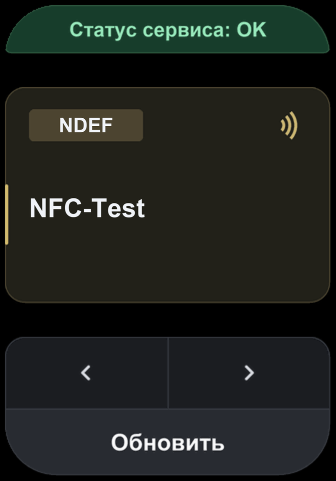
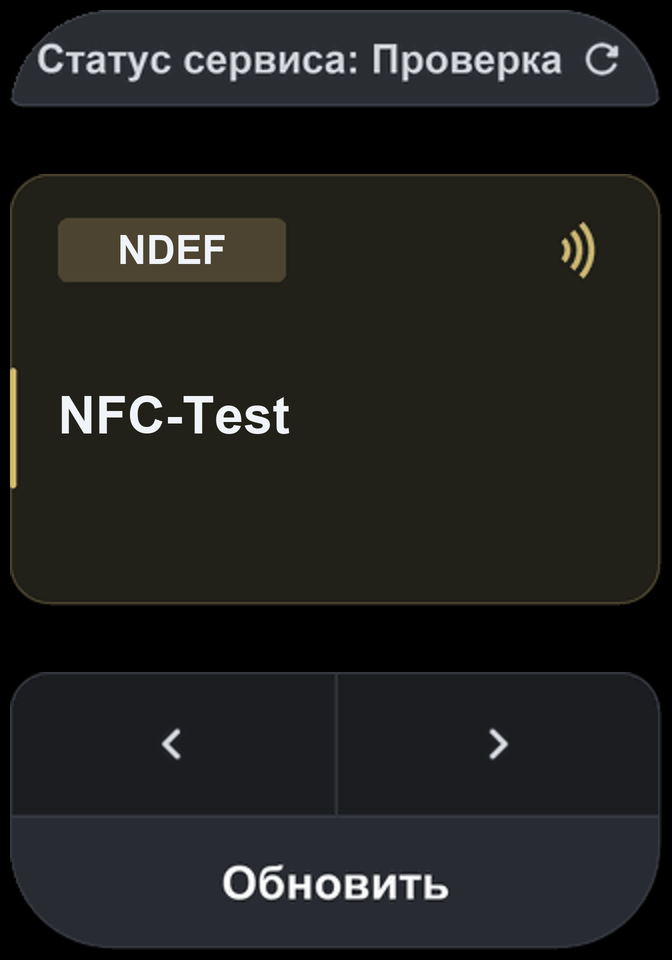

# MiBandNFC

**NFC-метки на Mi Smart Band 10 Pro Ceramic Global.** Android-приложение
считывает и сохраняет метки, передаёт выбранные записи на браслет по Bluetooth.
На браслете каталог открывается из общего списка приложений (**NFC-метки**). В установочном циферблате **Roundabout RU NFC 6** нижний круг после первой настройки работает как штатный **Find Phone**.
Поддерживаемые записи NDEF можно отдавать NFC-считывателю через подключённый Pixel.

[Скачать v1.0.0](https://github.com/RarogVA/MiBandNFC/releases/tag/v1.0.0) ·
[Изменения версии](docs/releases/v1.0.0.md) ·
[Установка](#установка) · [Документация](#документация)

## Интерфейс

Экран **«Пульт»**: карточка метки, верхняя кнопка состояния сервиса и нижний
блок управления. Усиленные жирные надписи, цветной бейдж технологии 114×41 px с рамкой
и одинаковыми скруглёнными углами, NFC-значок. Начертание текста бейджа сохранено.
Отступы учитывают скругление дисплея; между основными блоками одинаковое расстояние.

| Циферблат | Каталог меток |
| --- | --- |
|  |  |

Изображения получены из ресурсов текущей сборки. Динамические надписи MiSans
на рендерах приближённо показаны Arial Bold.

## Возможности

- Считывание NFC-меток на Pixel, сохранение имени, технологии и доступных данных.
- Выбор записей для передачи из приложения на браслет.
- Каталог до **32 меток**, до **1024 байт NDEF** на запись.
- Просмотр меток и переключение кнопками **‹ / ›** на одном экране без прокрутки.
- Три записи в общем списке приложений: **NFC-метки**, **Mi Home** и **Модули**.
- Первый тап по нижнему кругу установочного циферблата загружает модули и перезагружает браслет; после этого круг работает как **Find Phone**, а модули восстанавливаются автоматически.
- Динамический статус сервиса и ручное обновление локальных данных.
- Read-only **NFC Type 4 NDEF** через мост **NFC ↔ Bluetooth ↔ Pixel**.
- Русифицированный Roundabout с горизонтальными нижними подписями.

## Совместимость

| Компонент | Поддерживаемая конфигурация |
| --- | --- |
| Браслет | Mi Smart Band 10 Pro Ceramic Edition Global |
| Идентификатор | `miwear.watch.p67glt` |
| Прошивка | **3.201.026** |
| Телефон | Google Pixel 8a |
| Циферблат | Roundabout RU NFC 4, ID `999999990` |
| Android-приложение | Tag Bridge **0.4.1** |

**v1.0.0 — версия проекта.** В неё входят UI4, core v1 и APK 0.4.1;
версии отдельных компонентов могут различаться. Нативный модуль привязан к
точной модели и прошивке из таблицы — другие конфигурации не поддерживаются.

## Установка

1. Открыть [релиз v1.0.0](https://github.com/RarogVA/MiBandNFC/releases/tag/v1.0.0)
   и скачать `tag-bridge-0.4.1.apk` и `roundabout-ru-nfc4-p67glt.face`.
2. Установить APK на Pixel. Если уже установлена версия 0.4.1, менять её не нужно.
3. Передать `.face` на браслет через **Notify for Xiaomi**. Он появится отдельно
   под именем **Roundabout RU NFC 4**.
4. Выбрать новый циферблат и перезагрузить браслет, чтобы завершить переход
   с предыдущего модуля интерфейса.
5. Один раз нажать нижний круг установочного циферблата: модули загрузятся, браслет перезагрузится. После перезагрузки подождать около 2 секунд — записи появятся в общем списке приложений, а круг будет открывать штатный Find Phone.

ELF-файлы отдельно устанавливать не требуется — они уже встроены в циферблат.
В релизе также доступны архив исходников и `SHA256SUMS`.

## Использование

На Pixel считать метку или создать NDEF-запись, отметить нужные записи,
подключиться к браслету и запустить синхронизацию каталога. На браслете открыть
**«Метки»** и выбрать запись стрелками. Для NFC-обмена подтвердить выбранную
поддерживаемую запись в приложении Pixel и отдельно запустить NFC-сеанс.
Телефон должен оставаться подключённым, экран браслета — включённым.

| Элемент | Действие |
| --- | --- |
| **‹ / ›** | Предыдущая / следующая сохранённая метка; на границе каталога стрелка приглушается |
| **ОБНОВИТЬ** | Перечитать локальный каталог и состояние сервиса; передачу с Pixel запускают на телефоне |
| **СТАТУС СЕРВИСА: OK** | Сервис работает; иконка обновления скрыта |
| **СТАТУС СЕРВИСА: FAIL** | Ошибка или недоступный сервис; нажатие запускает попытку загрузки либо опрос состояния |
| **СТАТУС СЕРВИСА: ЖДИТЕ** | Выполняется запрос состояния; кнопка серая, иконка вращается, размеры блока сохраняются |

| FAIL | Запрос состояния |
| --- | --- |
|  |  |

## Ограничения

- Сохранение сведений о метке не означает возможность её эмуляции. Поддерживается
  read-only Type 4 NDEF; исходный UID, защищённые пропуска, домофонные и
  транспортные карты не клонируются.
- **Mir Pay и банковские платежи не реализованы.** Исследование платёжной
  интеграции сохранено в технической документации.
- Для NFC-обмена нужен подключённый Pixel. Самостоятельной эмуляции без телефона нет.
- Работа с погасшим экраном и пробуждение от NFC-поля не реализованы.
- Жесты «Быстрые действия» не поддерживают сторонние приложения: список из пяти действий фиксирован прошивкой, наш app ID туда не добавить без патча.
- Смена метки останавливает текущий NFC-сеанс. Загрузка, синхронизация и выбор
  метки сами по себе NFC не включают.
- Модули остаются в памяти до перезагрузки. Ошибка частичной загрузки может
  потребовать перезагрузить браслет.

## Разработка

Текущие компоненты находятся в `tags/`. Начальная лаборатория APDU сохранена
отдельно и описана в [архитектуре](docs/architecture.md).

| Каталог | Содержимое |
| --- | --- |
| `tags/android/` | Tag Bridge для Pixel, NFC-считыватель и BLE-клиент |
| `tags/catalog/` | Хранение каталога и протокол синхронизации |
| `tags/launcher/` | Нативный экран «Пульт», ресурсы и геометрия |
| `tags/bootstrap/` | Загрузка модулей из нижнего круга циферблата |
| `tags/roundabout/` | Русификация и оформление Roundabout |
| `releases/catalog-ui4/` | Файлы v1.0.0, изображения и манифест |
| `docs/` | Техническое задание, архитектура и история исследования |

Для сборки нужны Python 3, Pillow, JDK, Android SDK 36 / build-tools 36.0.0,
NDK 28.2.13676358 и Clang. Точные команды и зависимости:
[Android](tags/android/README.md), [core каталога](tags/catalog/README.md),
[UI4 и упаковка циферблата](tags/launcher/UI4.md).
Генерируемые файлы находятся в `build/`; готовые версии — в `releases/`.

## Дальнейшее развитие

- Улучшение диагностики соединения и экспорта журналов.
- Развитие совместимости NFC-считывателей и восстановления соединения.
- Исследование пробуждения от NFC-поля с учётом энергопотребления; пока это
  требование в ТЗ, а не фоновая функция приложения.

Подробные задачи и ограничения исследования — в [roadmap](docs/roadmap.md).

## Документация

- [Релиз v1.0.0](docs/releases/v1.0.0.md)
- [Экран UI4: геометрия, поведение и сборка](tags/launcher/UI4.md)
- [Каталог и протокол](tags/catalog/PROTOCOL.md)
- [История интеграции каталога](docs/catalog-v1.md)
- [Лаунчер, автозагрузка, Mi Home и «Модули»](docs/launcher-and-autostart.md)
- [Жесты и быстрые действия](docs/firmware/gestures.md)
- [Архитектура](docs/architecture.md)
- [Техническое задание](docs/technical-spec.md)

## Лицензия

Лицензия собственного кода пока не выбрана. Происхождение и условия использования
сторонних материалов описаны в [NOTICE.md](NOTICE.md). Проект не связан
с Xiaomi, НСПК или Mir Pay.
