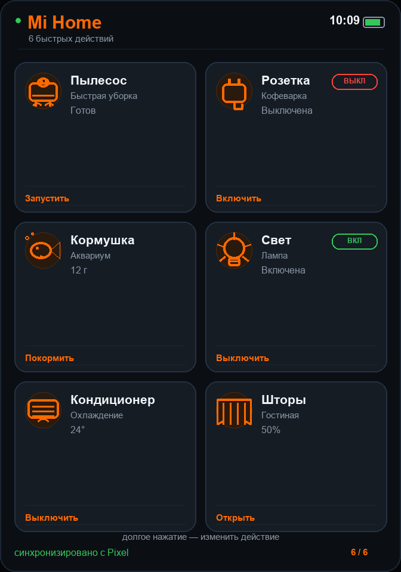

# Mi Home quick actions — design preview

**Статус: только проектирование.** Рабочего приложения Mi Home для браслета
пока нет: в этом документе архитектура, ограничения и макет экрана. Ничего
устанавливать из этого релиза нельзя; синхронизация с Mi Home не реализована.

## Задача

Третий вариант в нижнем круге циферблата — **Mi Home** с иконкой. На экране
6 быстрых действий: запуск уборки робота-пылесоса, вкл/выкл розетки,
покормить рыбок и т.д. Список и иконки должны синхронизироваться с Mi Home
через Pixel, а действия — редактироваться.

## Слои

| Слой | Что нужно | Статус |
| --- | --- | --- |
| Нижний круг | вариант Mi Home + иконка | не реализовано |
| Экран браслета | native-страница 2×3, 6 кнопок, состояния | не реализовано |
| BLE | список действий, состояния, команды, иконки | не реализовано |
| Pixel | настройка 6 действий, приём иконок, отправка команд | не реализовано |
| Mi Home | авторизация, устройства, управление | не реализовано |

## Почему это не правка .face

- Браслет не имеет сети: все запросы к Mi Home должны идти через Pixel или
  локальный бридж, по BLE — только готовые действия и состояния.
- У Mi Home **нет публичного API** для сторонних приложений. Официальный SDK
  доступен партнёрам, а не этому проекту.
- Неофициальные пути: `micloud` (Xiaomi Cloud, устройства, токены) и
  `miIO` (локальное/облачное управление). Это reverse-engineered API:
  регион, 2FA, токены, нестабильность и риск ограничений аккаунта.
- Разные устройства — разные команды: пылесос, розетка и кормушка для рыбок
  требуют отдельных адаптеров.
- Иконки Mi Home — proprietary; для браслета их нужно конвертировать в
  indexed8/84×84 и передать по BLE.

## Варианты интеграции

### A. Home Assistant как мост (рекомендуется)

`Band ↔ BLE ↔ Pixel ↔ Wi-Fi ↔ Home Assistant ↔ Mi Home/miIO`

HA уже умеет Xiaomi Mi Home, отдаёт сущности, состояния и иконки через
REST/WebSocket. Нужен HA-сервер (ПК/Raspberry Pi). Это не «напрямую Mi Home»,
но устройства те же и интеграция надёжнее.

### B. Неофициальный Mi Home Cloud на Pixel/бридже

`micloud` + `miIO` к аккаунту Xiaomi. Без HA, но токены/2FA, нестабильный
API, device-specific команды и вопросы безопасности.

### C. Официальный SDK

Недоступен для стороннего проекта.

## Ограничения

- **UI-ELF**: текущая страница NFC-меток занимает 9 841 байт; 6 кнопок с
  динамическими иконками могут не поместиться. Нужен новый ELF/слот и,
  вероятно, новый app ID/page.
- **Слот**: в нижнем круге 44 варианта; Mi Home можно поставить вместо одного
  из оставшихся пустых placeholder'ов, не потеряв стандартное приложение.
  45-й вариант не проверен.
- **Иконки**: динамические изображения нужно принимать, конвертировать и
  загружать в LVGL; память и размер ограничены.
- **Безопасность**: токены Mi Home нельзя хранить на браслете или в
  репозитории; только на Pixel/HA в защищённом хранилище. Лучше отдельный
  аккаунт.
- **6 кнопок**: сетка 2×3 помещается на 336×480, но редактирование лучше
  делать на Pixel, а не на браслете.

## Этапы

1. **Phase 1 — UI и протокол без облака.** Mi Home в Slot, 6-кнопочная
   native-страница, BLE-протокол, mock-синхронизация, проверка на браслете.
2. **Phase 2 — реальное управление.** HA или неофициальный cloud, 1–2
   устройства, синхронизация иконок.
3. **Phase 3 — продукт.** 6 настраиваемых действий, редактирование,
   offline/ошибки, безопасность, тесты, аппаратная приёмка.

## Что нужно решить

1. Маршрут: Home Assistant или неофициальный Mi Home Cloud.
2. Точные модели пылесоса, розетки и кормушки.
3. Есть ли HA/ПК/Raspberry Pi, который может быть онлайн.
4. Готовность к отдельному аккаунту Xiaomi и рискам неофициального API.
5. Начинать с Phase 1 (mock) или сразу с real cloud.

## Не входит в design preview

- Устанавливаемое приложение.
- Управление устройствами.
- Синхронизация с Mi Home.
- Иконки реальных устройств.
- Изменения в существующих `.face` или релизе v1.1.0-nfc5.
