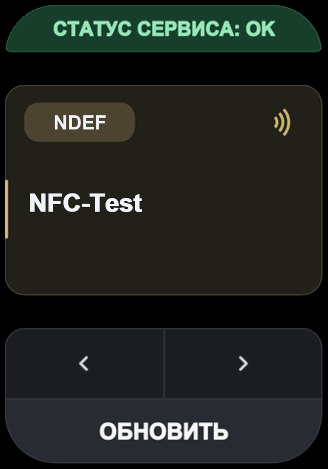
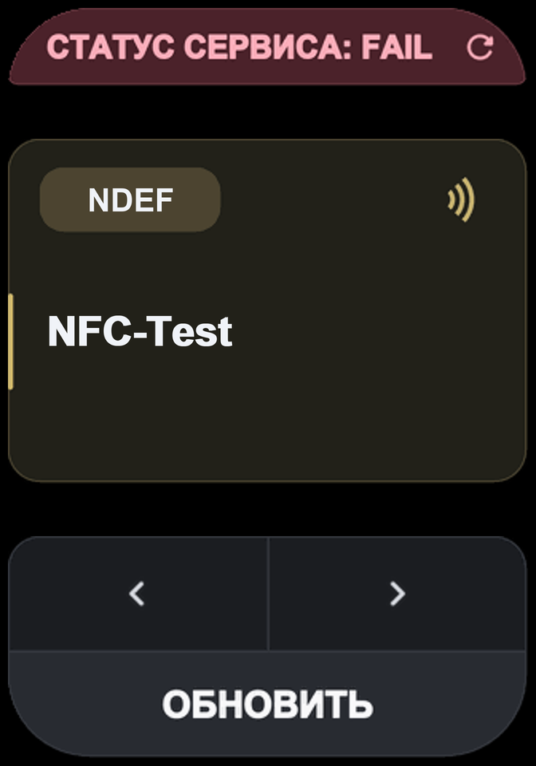
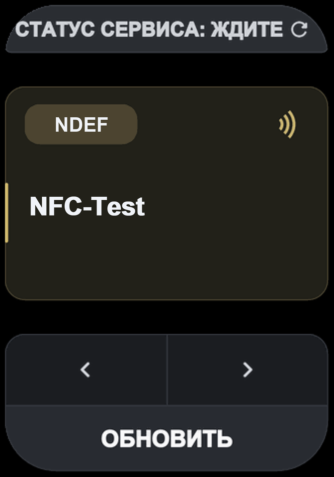
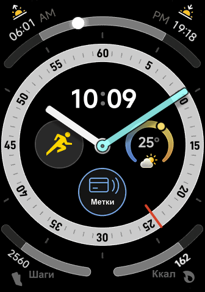

Экран NFC-меток получил тему **«Пульт»**: крупные жирные надписи, отдельную карточку и верхнюю кнопку состояния сервиса. Новый циферблат — **Roundabout RU NFC 4**, ID `999999990`.

Релиз **v1.0.0** исследовательского проекта для **Mi Smart Band 10 Pro Ceramic Global (`miwear.watch.p67glt`), прошивки 3.201.026 и Pixel 8a**.

## Экран текущей сборки

Это **офлайн-рендеры ресурсов**, не фотографии браслета. Динамические надписи MiSans приближённо показаны Arial Bold.

| OK | FAIL | ЖДИТЕ |
| --- | --- | --- |
|  |  |  |

## Что изменилось

- Поле 336×480, отступы от краёв 5 px. Верхняя кнопка и нижний блок учитывают скругление экрана; рамки страницы, прокрутки и нижней строки сообщений нет.
- Карточка выделена оливковым цветом и акцентной полоской. Тип метки — сверху слева, утолщённый NFC-значок — сверху справа, название — справа от полоски. Бейдж типа стал выше: **114×41 px**, все четыре угла скруглены одинаково (R15), рамка — 1 px. Центр бейджа выровнен с NFC-иконкой.
- Название **26 px**, статус **20 px** и кнопка **23 px** получили более жирное начертание. Текст бейджа **20 px** сохранён. Надписи кнопок — **«ОБНОВИТЬ»** и **«СТАТУС СЕРВИСА: …»**. Два промежутка между блоками равны **33 px**. Размеры статуса 326×49, карточки 326×216 и нижнего блока 326×139 сохранены.
- Статус — одна кнопка постоянного размера: зелёный **OK** без иконки, красный **FAIL** с иконкой обновления, серая **ЖДИТЕ** с анимацией. Проверка длится не более 20 секунд, а успешная загрузка модуля сама по себе не считается OK: необходим ответ живого сервиса без ошибки.
- Стрелки переключают сохранённые метки, недоступное направление приглушается. «ОБНОВИТЬ» перечитывает локальные данные; синхронизацию с Pixel по-прежнему запускают в Android-приложении.
- Загрузчик проверяет наличие всех 12 ресурсов до старта UI4. Повторная загрузка живого/частично загруженного модуля запрещена. UI-таймеры завершаются при уходе со страницы.

Нижний круг циферблата по-прежнему загружает модули и открывает страницу первым нажатием после перезагрузки. Горизонтальные подписи Roundabout и геометрия круглой кнопки сохранены; **490 исходных числовых ресурсов, их наклоны и координаты не изменены**.

## Файлы релиза

В Assets: новый `.face`, UI4 `.elf`, прежние **APK 0.4.1** и **core v1**, изображения, полный архив проекта и `SHA256SUMS`. APK и core побайтово совпадают с предыдущим релизом. ELF отдельно устанавливать не требуется: он встроен в FACE.

## Установка

1. Использовать только указанную модель и прошивку. На Pixel оставить APK 0.4.1 либо установить приложенный идентичный файл.
2. Передать `roundabout-ru-nfc4-p67glt.face` через Notify for Xiaomi. Он ставится отдельно под именем **Roundabout RU NFC 4**, с новым ID, чтобы не зависеть от замены прежнего циферблата в Notify.
3. Выбрать новый циферблат и **перезагрузить браслет** для перехода с резидентного UI1/UI2/UI3. Нажать нижний круг «Метки» один раз.
4. Синхронизировать выбранные записи с Pixel; проверить карточку и статус сервиса. Для NFC по-прежнему нужна отдельная ручная команда на Pixel.

Работа после сна, RF-пробуждение, прямое копирование защищённых пропусков и платежи Mir Pay в релиз не входят. Поддерживается экспериментальный read-only Type 4 NDEF через подключённый Pixel.
