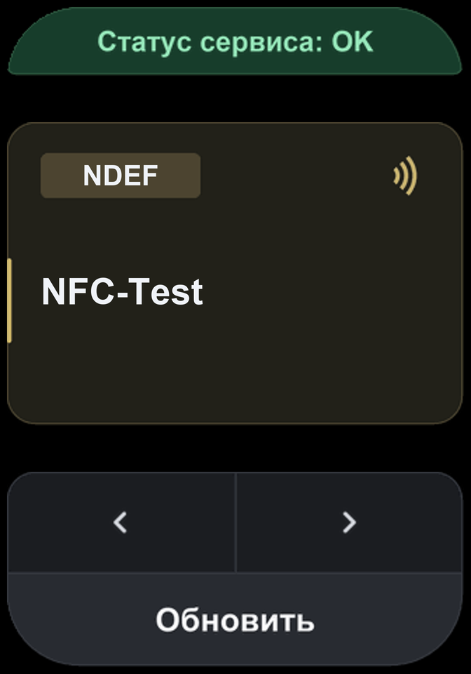
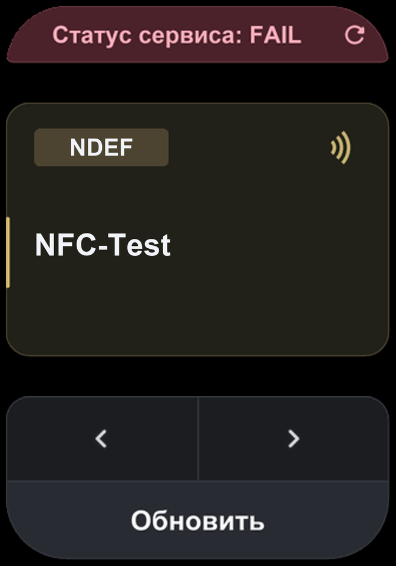
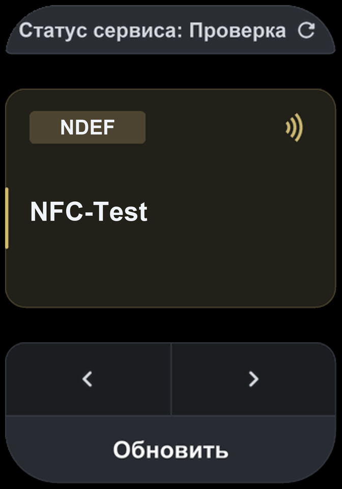

# Roundabout RU NFC 4 — v1.0.0

Один вариант экрана «Пульт» для **miwear.watch.p67glt / 3.201.026**.
Тема «Пульт», крупные жирные надписи и динамический статус сервиса.

| Файл | Назначение |
| --- | --- |
| `roundabout-ru-nfc4-p67glt.face` | Новый отдельный циферблат, ID 999999990; содержит core, UI4 и ресурсы |
| `nfc-tags-catalog-ui-v4.elf` | Нативная страница UI4, также встроена в FACE |
| `catalog-core-v1.elf` | Прежнее ядро каталога, без изменений |
| `tag-bridge-0.4.1.apk` | Прежнее приложение Pixel, без изменений |
| `nfc-tags-ui4*.png` | Офлайн-рендеры OK / FAIL / Проверка |
| `roundabout-preview.png` | Превью из циферблата |
| `*-validation.json`, `ui-tests.json`, `*-build.json`, `font-evidence.json` | Отчёты сборки и проверок |
| `manifest.json`, `SHA256SUMS` | Состав, ограничения и контрольные суммы |

Название 26 px; тип и статус 20 px; «Обновить» 23 px. Все надписи жирные.
Промежутки между тремя блоками равны 33 px при прежних размерах блоков;
внешние поля 5 px учитывают скругление экрана.

Изображения получены из ресурсов сборки, это не фотографии браслета.
Динамические надписи MiSans приближённо показаны Arial Bold.

[Описание релиза и порядок установки](../../docs/releases/v1.0.0.md) ·
[Устройство UI4 и команды сборки](../../tags/launcher/UI4.md).
