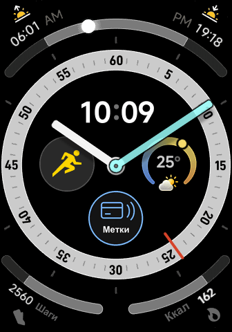

# Roundabout RU NFC 5 — выбор приложения в нижнем круге

> **Новее:** готовы три циферблата с установщиком и автозагрузкой —
> **SmartRound #1** (основные темы), **SmartRound #2** (авторские темы)
> и **SmartRound #3** (исходные темы). Первый тап по нижнему кругу
> загружает модули и перезагружает браслет; после этого круг работает как выбранное штатное
> приложение, а приложения запускаются из меню. См.
> [watchfaces](../../docs/watchfaces.md) и
> [launcher-and-autostart](../../docs/launcher-and-autostart.md).
> Описанный ниже NFC 5 остаётся отдельным кандидатом.

Кандидат **Roundabout RU NFC 5**, ID **999999989**, для miwear.watch.p67glt
/ **3.201.026**. Это отдельная сборка, а не замена релизу v1.0.0.

В релизе v1.0 нижний круг жёстко закреплён за **«NFC-метки»**. В NFC 5
сохранены **43 стандартных варианта Roundabout** и вместо пустого варианта
добавлен **«NFC-метки»**. В редакторе циферблата можно выбрать любое
стандартное приложение или наш экран; круг рисует выбранный значок.

## Как выбрать

1. Установить .face и открыть редактор циферблата Roundabout.
2. Выбрать нижний круг (позиция 126, 274).
3. Выбрать стандартное приложение или **«NFC-метки»**.

- **Стандартное приложение** запускается штатным действием Widget; наш Lua
  и загрузка модулей не участвуют.
- **«NFC-метки»** сохраняет прежний ручной bootstrap: первый тап копирует
  модули и открывает экран каталога, последующие тапы открывают его напрямую.
- Остальные два круга, часы, метрики, темы и AOD не меняются.

## Что именно изменено

- В восьми нижних Slot (четыре обычные темы и четыре AOD) последний
  **пустой** вариант заменён на новый Widget с app ID **0xD4**.
- Количество вариантов остаётся **44**, чтобы не менять геометрию и
  разбиение редактора. Поэтому стандартных вариантов остаётся **43**;
  вариант «пусто» больше не доступен.
- В обычных темах новый Widget получает Lua-дочерний ресурс для ручного
  bootstrap; в AOD — только значок и действие, без Lua.
- Остальные **2440** исходных ресурсов сохраняют offset, size и байты.
- Добавлены новые image/translation/Widget/Slot payloads и FileResource
  записи; исходные payloads не перезаписаны.

## Сборка

Нужен Python с Pillow (в проекте — research venv) и собранные core/UI:

    build/shortcut-research-venv/bin/python tags/bootstrap/build_choice_face.py \
      --core tags/catalog/build/catalog_core_v1.elf \
      --ui tags/launcher/build/nfc_tags_catalog_ui_v4.elf

Результат:

- build/roundabout-ru-nfc5.face — **3 424 691 байт**,
  SHA-256 d650dd4c3cd9ce7f5a5a2da5ccff4e410e6ffbaf97aeafbda178769bf3a2c560;
- [choice_validation.json](choice_validation.json) — отчёт проверки,
  hardware_tested: false.

Скрипт проверяет SHA-256 исходного Roundabout RU, образа прошивки и архива
исходников, сохраняет 43 стандартных UID, проверяет action app ID 0xD4,
Lua-ссылку, FileResource roundtrip и неизменность исходных ресурсов.

## Ограничения

- Это **не** runtime-меню на браслете: выбор выполняется в редакторе
  циферблата. Отдельная native-страница выбора приложений — другая задача.
- Вариант «пусто» заменён; если он нужен, потребуется отдельная схема
  добавления 45-го варианта и проверка редактора.
- AOD получает значок и действие, но без Lua; загрузка модулей из AOD не
  предусмотрена.
- Изображение предпросмотра — рендер, а не фотография устройства.
- Аппаратная приёмка не выполнена: нужно проверить список редактора, запуск
  стандартного приложения, выбор «NFC-метки», первый тап/bootstrap, Back и
  все четыре темы/AOD.

## Приёмка на устройстве

- [ ] Редактор показывает 44 варианта, включая «NFC-метки» последним.
- [ ] Стандартное приложение из нижнего круга запускается.
- [ ] «NFC-метки» после первого тапа загружает модули и открывает каталог.
- [ ] Повторный тап, Back и возврат на циферблат работают.
- [ ] Остальные два круга и AOD не изменились.
- [ ] После перезагрузки первый тап снова выполняет bootstrap.
