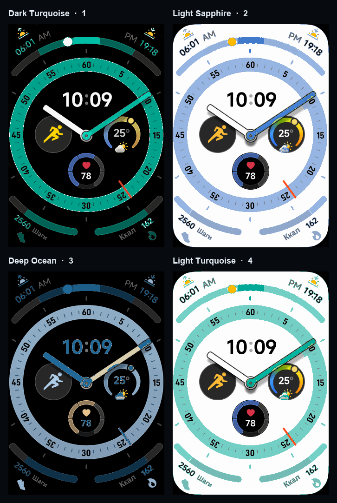

# NFC 5 Four — один циферблат, четыре темы

> **Новее:** три циферблата с установщиком и автозагрузкой —
> **SmartRound #1**, **SmartRound #2** и **SmartRound #3**. См.
> [watchfaces](../../docs/watchfaces.md). Описанный ниже NFC 5 Four остаётся
> отдельным кандидатом.

Отдельный циферблат **NFC 5 Four**, ID **999999979**, для
`miwear.watch.p67glt` / **3.201.026**. В одном `.face` — четыре обычных
стиля и четыре AOD.

| Стиль | Тема | Окно |
| --- | --- | --- |
| 1 | Dark Turquoise | тёмное |
| 2 | Light Sapphire | светлое |
| 3 | Deep Ocean | тёмное |
| 4 | Light Turquoise | светлое |



## Что сделано

- **Стиль 2 — полный клон светлого стиля 4** (дескриптор, таблицы ресурсов,
  Slot, раскладка) с отдельными перекрашенными ресурсами. Формат держит
  только один светлый базовый стиль, поэтому без клона две светлые темы в
  одном `.face` не умещаются.
- **Светлые темы:** безель, дорожка прогресса солнца и две нижние полосы
  (Шаги/Ккал) предварительно смешаны с белым (55% акцента) — визуальная
  полупрозрачность без зависимости от альфа-композитинга indexed8.
- **Тёмные темы:** те же элементы смешаны с чёрным (85% акцента), минутная
  стрелка — полный акцент.
- **Солнце:** перекрашены все 9 кадров `时间段` (ImageArray): дорожка —
  акцент с прозрачностью, само солнце — акцент.
- **Две нижние полосы:** перекрашены все 11 кадров обоих ImageArray
  (левая и правая полосы). Для тёмного стиля 1 не хватало записи левой
  полосы в его таблице — она добавлена из стиля 3 и перекрашена отдельно.
- **AOD:** четыре AOD-темы (1/2/3/4) перекрашены в приглушённый акцент;
  отдельные AOD-превью не рисуются.
- **Нижний круг** с 43 стандартными приложениями и «NFC-метки» сохранён.
- Остальные ресурсы не перезаписываются; изменяются только целевые
  image-ресурсы, index entries, дескрипторы клона и превью.

## Сборка

Нужен базовый NFC 5:

```sh
build/shortcut-research-venv/bin/python tags/bootstrap/build_choice_face.py \
  --core tags/catalog/build/catalog_core_v1.elf \
  --ui tags/launcher/build/nfc_tags_catalog_ui_v4.elf
```

Затем:

```sh
build/shortcut-research-venv/bin/python tags/roundabout/combined_face.py
```

Результат:

- `build/roundabout-ru-nfc5-four.face` — **3 917 994 байт**,
  SHA-256 `019b1a7678e6d632f56d55d9a3b9a0b4405e1ea33a5c5aca69a4ca054ba421f5`;
- [four-preview.png](four-preview.png) — контактный лист 2×2;
- [four_validation.json](four_validation.json) — стили, дескрипторы, SHA-256,
  размер и ограничения.

## Установка

1. Установить `.face`.
2. Открыть редактор Roundabout: в нём четыре стиля в порядке из таблицы.
3. Выбрать нужный стиль; AOD включается автоматически.
4. Нижний круг настраивается как раньше — стандартное приложение или
   «NFC-метки».

## Ограничения

- Аппаратная приёмка не выполнена: установка, редактор, клон стиля 2,
  AOD и нижние полосы ещё не проверены на браслете.
- «Полупрозрачность» — предварительное смешение с белым/чёрным в indexed8,
  а не runtime-альфа. Если нужна настоящая альфа-композиция, потребуется
  отдельная проверка рендера.
- Стиль 2 — статический клон стиля 4; изменения раскладки/ресурсов стиля 4
  после сборки в клон не попадут.
- Превью — рендеры, не фотографии устройства.
- Это отдельный `.face`; остальные девять цветовых вариантов остаются
  отдельными файлами.
