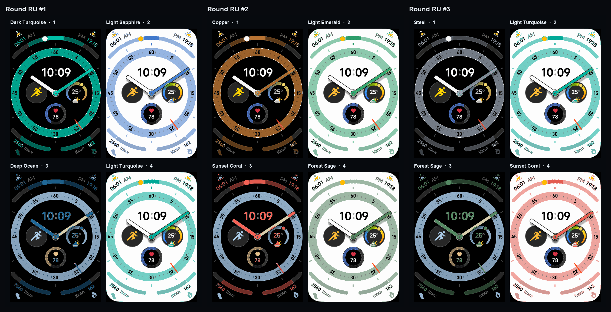

# Round RU #1–#3 — чистые тематические циферблаты

Три отдельные русифицированные копии **Roundabout RU** без нашего
функционала и без инжекта:

- нет NFC-меток и каталога;
- нет лаунчера, одного тапа, installer-слоя и перезагрузки;
- нет Mi Home и BLE;
- нет Lua-слоёв и дополнительных приложений;
- нижние круги и штатные действия Roundabout остаются как в оригинале.

Отличаются только цветовые темы и имя/ID FACE. Русские подписи
(Шаги, Ккал, ЧСС, дни недели, «ч.») сохраняются из базы **Roundabout RU**.

| FACE | ID | Темы |
| --- | --- | --- |
| **Round RU #1** | 999999974 | Dark Turquoise, Light Sapphire, Deep Ocean, Light Turquoise |
| **Round RU #2** | 999999973 | Copper, Light Emerald, Sunset Coral, Forest Sage |
| **Round RU #3** | 999999972 | Steel, Light Turquoise, Forest Sage, Sunset Coral |

## Размеры и SHA-256

| FACE | Байт | SHA-256 |
| --- | ---: | --- |
| Round RU #1 | 3 572 663 | 0936dd7f66bd80853970d0374623fb3c8aba0c34986e5435e3916aafd62a5116 |
| Round RU #2 | 3 556 979 | 5f864f4779f4f2d8482db838c6aa731e0a9ae71708173200280e4716a4998bb2 |
| Round RU #3 | 3 577 475 | da276459a14d33f5b2940e76b4238fd21050f3ca59e73f15a73952ec2e253361 |

База: build/roundabout-ru.face, SHA-256
b7875710957e54f4feee042ff1bcbc766f2fb49afc8cde19d4e047aa0e3bd3b2
(3 079 695 байт). Это уже русифицированный Roundabout без нашего inject.

## Сборка

Нужна чистая база Roundabout RU:

~~~sh
BASE=build/roundabout-ru.face
SHA=b7875710957e54f4feee042ff1bcbc766f2fb49afc8cde19d4e047aa0e3bd3b2
build/shortcut-research-venv/bin/python tags/roundabout/combined_face.py \
  --base-face "$BASE" --base-sha "$SHA" --palette main \
  --face-id 999999974 --face-name "Round RU #1" \
  --output build/round-ru-1.face \
  --report tags/roundabout/round_ru_1_validation.json \
  --preview tags/roundabout/round-ru-1-preview.png
~~~

Для #2 заменить --palette custom, ID 999999973, имя Round RU #2,
выходы на round-ru-2; для #3 — --palette mix, ID 999999972,
имя Round RU #3, выходы на round-ru-3.

Сборщик берёт только чистую базу, перекрашивает безель, минутную
стрелку, дорожку солнца, нижние полосы и AOD, обновляет превью, ID и имя.
Он не добавляет Lua, приложения, Slot-действия NFC или ресурсы Mi Home.

## Установка

1. Передать нужный .face на браслет через Notify for Xiaomi.
2. В галерее появятся Round RU #1, Round RU #2, Round RU #3.
3. Выбрать циферблат; первый тап/перезагрузка не нужны — это обычные темы.
4. Нижние круги и действия остаются штатными Roundabout.

## Ограничения

- Аппаратная приёмка установки, редактора, тем, AOD и нижних полос не
  выполнена.
- «Полупрозрачность» — предварительное смешение indexed8, не runtime-альфа.
- Превью — рендеры, не фотографии устройства.
- Стиль 2 в #1–#3 — статический клон светлого стиля 4; правки стиля 4
  после сборки в клон не попадут.
- Оригинального Roundabout среди этих трёх нет; #3 — тоже перекрашенный
  набор, а не оригинал.
- Формат по-прежнему 4 стиля + 4 AOD на FACE.
