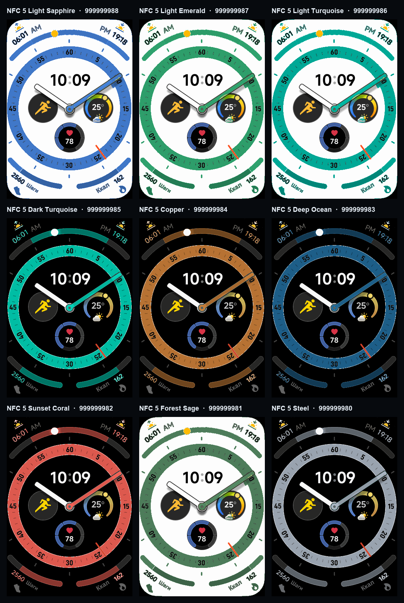

# Roundabout RU NFC 5 — цветовые темы

Отдельный собранный циферблат с четырьмя темами (Dark Turquoise, Light
Sapphire, Deep Ocean, Light Turquoise) и четырьмя AOD описан в
[FOUR.md](FOUR.md).

## Ограничение формата

`.face` и редактор Roundabout рассчитаны ровно на **4 обычных стиля + 4 AOD**.
Восемь theme-дескрипторов — это не «сколько влезет», а формат: в заголовке
стоит 8, редактор показывает 4 стиля и AOD к каждому. Поэтому девять новых
тем **нельзя** положить в один `.face` без изменения формата и редактора.

Сделано иначе: каждая тема — **отдельный `.face`** с теми же четырьмя стилями.
В нём заменён один базовый стиль:

- светлые варианты заменяют **стиль 4** (светлый);
- тёмные варианты заменяют **стиль 1** (тёмный).

Остальные три стиля остаются базовыми. Нижний круг с 43 стандартными
приложениями и «NFC-метки» сохраняется во всех вариантах.

## Варианты

| Название | ID | База | Безель | Минутная стрелка |
| --- | --- | --- | --- | --- |
| NFC 5 Light Sapphire | 999999988 | светлая | синий | синий |
| NFC 5 Light Emerald | 999999987 | светлая | изумрудный | зелёный |
| NFC 5 Light Turquoise | 999999986 | светлая | бирюзовый | бирюзовый |
| NFC 5 Dark Turquoise | 999999985 | тёмная | бирюзовый | бирюзовый |
| NFC 5 Copper | 999999984 | тёмная | медь | янтарный |
| NFC 5 Deep Ocean | 999999983 | тёмная | глубокий синий | голубой |
| NFC 5 Sunset Coral | 999999982 | тёмная | коралл | персиковый |
| NFC 5 Forest Sage | 999999981 | светлая | шалфей | мятный |
| NFC 5 Steel | 999999980 | тёмная | сталь | серебро |



## Что меняется

- Цвет безеля: серая кольцевая зона фона перекрашивается с сохранением
  светотени; чёрные цифры/риски и белая страница/чёрный фон не меняются.
- Минутная стрелка: основной цвет перекрашивается; чёрная тень остаётся.
- AOD: кольцо и минутная стрелка получают приглушённый вариант цвета.
- Превью стиля и главная миниатюра `.face` перерисовываются, чтобы вариант
  было видно в галерее и редакторе.
- Нижний круг (43 приложения + «NFC-метки»), остальные стили, часы, дата,
  метрики и раскладка не меняются.

Светлые варианты получили в тон не только безель, но и минутную стрелку —
иначе исходная зелёная стрелка спорила бы с синим/бирюзовым кольцом. Если
нужен строго «только безель», это отдельная правка палитры.

## Сборка

Сначала нужен базовый NFC 5:

```sh
build/shortcut-research-venv/bin/python tags/bootstrap/build_choice_face.py \
  --core tags/catalog/build/catalog_core_v1.elf \
  --ui tags/launcher/build/nfc_tags_catalog_ui_v4.elf
```

Затем все девять вариантов:

```sh
build/shortcut-research-venv/bin/python tags/roundabout/theme_variants.py
```

Результат:

- `build/theme-variants/<slug>.face` — девять отдельных циферблатов;
- `build/theme-variants/<slug>.png` — превью каждого;
- `build/theme-variants/roundabout-ru-nfc5-themes.zip` — архив со всеми
  `.face`, превью, контактным листом и `manifest.json`;
- [themes_validation.json](themes_validation.json) — SHA-256, ID, размеры,
  UID изменённых ресурсов;
- [themes-preview.png](themes-preview.png) — контактный лист.

Скрипт проверяет SHA-256 базового NFC 5, сохраняет все остальные ресурсы,
перекрашивает только целевые image-ресурсы и превью, обновляет index entries
и проверяет, что изменены только разрешённые байты префикса.

## Установка и выбор

1. Установить нужный `.face` (или несколько).
2. Открыть редактор циферблата Roundabout.
3. Для светлых вариантов выбрать **стиль 4**; для тёмных — **стиль 1**.
4. Нижний круг настраивается как раньше: стандартное приложение или
   «NFC-метки».

Главная миниатюра каждого `.face` показывает вариант, но базовый стиль 1
остаётся первым; светлый вариант нужно выбрать в редакторе.

## Ограничения

- Девять тем — это девять отдельных `.face`, а не один файл. Формат/редактор
  на 4 стиля; расширение до 13+ стилей не исследовано и не заявляется.
- AOD-превью отдельно не рисуются; AOD перекрашивается в самом `.face`.
- Превью — рендеры, не фотографии устройства.
- Аппаратная приёмка не выполнена: нужно проверить установку, галерею,
  переключение стилей, AOD и сохранность нижнего круга на каждом варианте.
- Цвета безеля и стрелки — дизайнерские; точная передача зависит от
  квантования indexed8 и дисплея.
